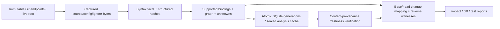

# Ripple architecture

All six CLI commands compose implemented libraries. Production has three boundaries: syntax facts, semantic graph resolution, then impact/change/test analysis. Node/TypeScript is evaluation-only. SQLite is bundled and local; Git is an argument-array subprocess adapter with bounded reads, environment isolation and no lazy fetch.

| Crate | Responsibility | Internal production dependencies |
|---|---|---|
| ripple-core | Validated source/identity/syntax/graph/revision/result contracts | none |
| ripple-parse | Capability-relative scanning, bounded TS/TSX parsing/extraction/hashes | core |
| ripple-resolve | Captured config/module/export/direct-reference rules and uncertainty | core |
| ripple-index | Captured cold/incremental orchestration, freshness and atomic SQLite/cache | core, parse, resolve |
| ripple-git | Pinned refs, trees/blobs, hunks and provenance | core |
| ripple-impact | Adjacency/traversal, symbol changes, revision/test evidence | core |
| ripple-cli | Provider/engine composition and human/versioned JSON | owning libraries |

## Inputs and durable state

RepoPath uses portable relative UTF-8 spelling, rejects escapes/control characters and preserves case. Scanning rejects case collisions, anchors reads through directory capabilities, excludes symlinks and known generated/dependency/index folders, and records source/config/ignore membership and bytes. Source positions are UTF-8 byte offsets with one-based byte display columns. Captures are verified again before atomic publication, with at most three attempts. This is not an OS-atomic snapshot; later edits make a published generation stale.

SQLite schema v2 is authoritative. Complete immutable generations include captured inputs, validated facts/graph and a sealed analysis/fingerprint cache. Derived metadata/module sidecars are recoverable, not the source of truth. Reader transactions see one generation; failed capture/build/publication preserves the prior one. Corrupt state fails explicitly; unsupported schema repair is archive/rebuild, never silent deletion. No archive GC is implemented. [Storage](storage.md), [capture/storage decisions](adr/0021-cold-index.md) and [cache](adr/0025-incremental-cache.md).

## Identity, syntax and semantics

Symbol IDs use project/path/qualified-name/kind/disambiguator, excluding offsets, revision and DB row IDs. Hashes use versioned node structure and meaningful lexical content, preserving ASI, strings/templates/TSX text. Extraction retains lexical scopes, reference ownership and diagnostics; Tree-sitter is not semantic proof. Module lookup consumes captured config and inventory; export closure preserves original declarations, transfer witnesses and missing probes. Supported direct calls/reads respect lexical shadowing and type-only imports. Unsupported constructs remain unknown. [Resolution](resolution.md) and [hash decision](adr/0012-syntax-hashes.md).

Incremental refresh reuses only content/version-bound facts, then guarded module/reference results where complete input/external-surface equality proves applicability. Config/package/lock/ignore/policy and missing-probe changes can trigger full fallback. Inventory/coordinate/unknown changes rebuild conservatively. Full canonical snapshot plus module/config/discovery equality gates reuse. A no-op still verifies inputs and publishes a generation; zero parses does not mean zero writes or latency. [Incremental](incremental.md).

## Historical and query workflows

Diff/test pin A..B once, build independent in-memory endpoint snapshots from immutable blobs and classify supported symbols/files using both sides. They never publish the user's index or checkout files. Path-based identity means renames can be delete/add; global inputs seed explicit policy fallback. Existing-path metadata distinguishes absent old tests from present-unindexed paths.

Queries build adjacency once per graph and reverse-walk CALLS/REFERENCES separately from DEFINES-at-seed then IMPORTS/REEXPORTS. No containment expansion enters the semantic track. Witnesses retain seed, endpoint, track, original hops/provenance and weakest confidence. Deterministic BFS chooses shortest paths with documented ties. Display limits preserve full JSON sets; depth boundaries and graph-wide unresolved context remain visible. Test selection projects validated revision evidence into head/absent/unindexed partitions, using supported head tests as ratio denominator. [Graph model](graph-model.md) and [test decision](adr/0030-test-impact.md).

## Verification and measurements

[Evaluation](evaluation.md) and [benchmarks](benchmarks.md) link finite fixtures, compiler agreement, generated cold equality, real-history replay, controlled runtime faults and stage/resource measurements. The phase helper includes actual capture source and checks equality with the production query. No stat-only freshness optimization is shipped. Supported OS installation is tested through CI and the final artifact gate; exact candidate evidence belongs in the release checklist. Trust/resource boundaries are in [limitations](limitations.md).
