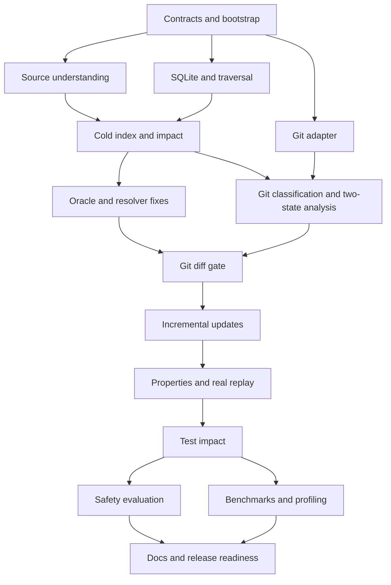

# Ripple implementation plan

## Approach and scope

Build the local Rust CLI in vertical slices, establish deterministic data contracts first, measure resolver quality early, and optimize incremental work only behind cold-equality evidence. The authoritative scope is [the build specification](../ripple_buildspec.md); this plan turns it into assignable work with explicit dependencies and independently checkable exits.

This plan began with only documentation and a Python planning helper. The task ledger is authoritative for current implementation status; do not interpret planned cards as completed features. The 6–8 week semester target remains aspirational: calendar estimates assume focused work and may expand when correctness gates expose defects. Preserve scope and gates before preserving dates.

- **In:** Rust workspace/CLI; TS/TSX syntax and supported resolution; SQLite graph; Git endpoint comparisons; impact witnesses and uncertainty; incremental correctness; oracle/test safety/performance evidence; installable release artifacts.
- **Out:** frontend, authentication, cloud backend, LLM features, complete TypeScript semantics, full monorepos, LSP, individual test-case selection, guaranteed-complete test sets.
- **Operating instructions:** [AGENTS.md](../AGENTS.md), [execution protocol and defaults](planning/execution-protocol.md), [machine-readable task ledger](planning/tasks.json), [task report template](task-reports/TEMPLATE.md).

## Milestones and acceptance gates

| Milestone | Target | Exit gate |
|---|---|---|
| M0 — Contracts and bootstrap | Before week 1 | Workspace checks and planning validator pass; staged syntax, graph and index contracts/ADRs support independent implementation. |
| M1 — Source understanding | Week 1 | inspect returns deterministic facts for supported TS/TSX fixtures, including spans and explicit parse/unsupported diagnostics. |
| M2 — Persistent graph and impact | Week 2 | A fresh index survives reload and returns the expected multi-file reverse path with confidence and provenance; v0.1 candidate. |
| M3 — Resolver oracle | Week 3 | A pinned external repository produces a reproducible resolver agreement report with documented mapping and mismatch categories. |
| M4 — Git-aware impact | Week 4 | A real branch comparison maps endpoint changes to symbols and explains base/head downstream paths, including deletions; v0.2 candidate. |
| M5 — Incremental updates | Week 5 | Generated equality tests pass before early cutoff; a one-file body edit reuses unchanged parses and matches cold output; config changes trigger rebuild. |
| M6 — Incremental correctness | Week 6 | Property suites, idempotence, persistence equality, and a pinned real commit replay have zero canonical mismatches; v0.3 candidate. |
| M7 — Test-file impact | Week 7 | test emits an explainable, deterministic set of potentially related test files on fixtures and a pinned real repo. |
| M8 — Safety evidence and release readiness | Week 8 | Resolver, replay, mutation, benchmark and install evidence exists; another developer can install/use the tool; v0.4 release-ready artifacts. |

Milestone gates pass in order. Internally, a later-milestone card may start as soon as its explicit dependencies are integrated; this allows storage, graph and Git adapters to be developed alongside parsing. A milestone exits only when all its required cards are `done`, previous milestone gates pass, and its own evidence is recorded. Releases in this table are candidates/readiness targets, not automatic publication.

## Invariants that every agent protects

| ID | Invariant |
|---|---|
| I1 | Syntax, semantics and impact stay separate; core types have no backend dependencies. |
| I2 | Semantic identity ignores line shifts, DB IDs, revisions and machine-specific absolute paths; paths remain repository-relative. |
| I3 | All results and canonical state are deterministic; confidence/provenance/diagnostics survive persistence. |
| I4 | RESOLVED means a supported deterministic rule proves one target; ambiguity remains candidate/unresolved, with evidence. |
| I5 | Every impact result has a valid revision-labelled witness under a documented graph transition policy; limits/incompleteness are visible. |
| I6 | Git comparisons use both endpoint states and retain deleted/removed paths without modifying the working tree. |
| I7 | Persistent generations are atomic, version/config/content compatible and recoverable; queries never silently use stale state. |
| I8 | Canonical incremental state equals canonical cold state after every supported change; cutoff is conditional on proven invalidation rules. |
| I9 | Accuracy, safety and performance claims come from reproducible measurements; related tests are never claimed sufficient. |

## Crate boundaries and ownership

| Crate | Owns | Allowed internal dependencies |
|---|---|---|
| ripple-core | Typed facts, IDs/spans, snapshots, diagnostics/results, canonical representation contracts | none |
| ripple-parse | Scanner, TS/TSX parser, syntax extraction and hashes | ripple-core |
| ripple-resolve | Module/export/call resolution, confidence evidence, resolution dependency records | ripple-core |
| ripple-index | Cold/incremental orchestration, fingerprints, SQLite, migrations, persisted generations | ripple-core, ripple-parse, ripple-resolve |
| ripple-git | Immutable refs, tree/blob sources, file changes, hunks, rename hints | ripple-core |
| ripple-impact | Adjacency, reverse queries/witnesses, change classification, base/head union, test reachability | ripple-core |
| ripple-cli | Commands, presentation, composition of Git/index/impact | all as needed |

Pass source snapshots and graph facts across boundaries. `ripple-resolve` consumes extracted records rather than Tree-sitter trees. `ripple-impact` consumes graph snapshots rather than reaching into SQLite or Git processes. CLI composes revision providers with index building and impact comparison. Shared contract, Cargo manifest, lockfile and integration ledger changes have one coordinator writer. Paths below describe ownership areas; exact Rust filenames may be refined without changing subsystem boundaries.

## Scheduling and asynchronous lanes

Use exact task dependencies in the ledger for dispatch, not just the diagram. Example parallel waves:

1. Start M0-T01 → M0-T02 → M0-T03. Parser/scanner work may then proceed while M0-T04 → M0-T05 establish graph/index contracts. Freeze only each consumer boundary before its users start; avoid designing every future API in one card.
2. Run scanner (M1-T01), parser/extraction chain (M1-T02→T03→T04), and a backend lane (M2-T03 storage, M2-T04 traversal, M4-T01 Git adapter sequentially or with available slots). Independent ownership permits overlap; shared manifests still go through the coordinator.
3. Run relative-module resolution, effective config (M2-T06), re-exports (M2-T07), then call resolution after extracted facts; finish inspect and cold index integration. While oracle work proceeds, Git symbol comparison can proceed against the frozen cold pipeline.
4. Converge the oracle-supported baseline and two-revision engine at M4; implement conservative incremental updates, establish M5-T05 property tests, then optimize invalidation under those tests. Expand correctness/replay evidence in M6. Test graph connectivity is designed in M0/M2, so M7 is a product/evaluation slice rather than a late graph redesign.
5. After M7, run safety evaluation and performance evidence independently, then converge docs/install/release readiness.

No dependent work uses an unintegrated worker branch. Ready independent tasks may continue while a blocker is escalated. Cards are work packages; split any remaining card exceeding one focused session (roughly half a day to two days) before dispatch. Use child IDs (for example M2-T03.1) with explicit dependencies/ownership/checks in both plan and ledger. Replace the original card’s prerequisites with its child IDs and retain it only as a final integration/revalidation task. Children inherit the original prerequisites rather than depending on their parent; downstream cards still depend on the parent. This avoids a parent/child dependency cycle. The coordinator must update both plan and ledger when splitting or changing dependencies.

## Task cards

Every card requires a preflight statement and `docs/task-reports/<ID>.md` on handoff. The coordinator verifies the card's checks plus applicable repository checks before `done`. Follow the report template even for blocked work. Acceptance below specifies behavior; the owning task creates/document its runnable test command when the harness does not yet exist.

### M0 — Contracts and bootstrap

#### M0-T01 — Bootstrap the Rust workspace and validation

- **Depends on:** none. **Lane:** foundation.
- **Own:** `Cargo.toml`; `Cargo.lock`; `rust-toolchain.toml`; `crates/*/Cargo.toml`; `.github/workflows/ci.yml`; `CONTRIBUTING.md`; `.gitignore`.
- **Implement:** Create the seven spec crates and CLI binary, choose/pin compatible dependencies, document toolchain/MSRV and local commands, ignore .ripple and build output, and add Linux/macOS/Windows fixture CI. Keep crate bodies minimal. Choose CI actions from official maintained sources at implementation time. Add Python 3 stdlib planning-validator tests and ledger validation to CI; this tooling is a contributor dependency, not a production CLI dependency.
- **Acceptance:** All crates build; fmt, clippy, and workspace tests pass; CLI --help and --version work; CI has an explicit matrix and locked dependency installation. No claim that unimplemented commands work. The planning validator and its tests run in CI.
- **Handoff:** Executable workspace and shared dependency policy; coordinator owns future manifest/lockfile edits.

#### M0-T02 — Establish source, identity and syntax-fact contracts

- **Depends on:** M0-T01. **Lane:** core.
- **Own:** `crates/ripple-core/src/{identity,source,syntax}*`; `docs/architecture.md`; `docs/adr/0001-rust-core.md`; `docs/adr/0002-tree-sitter-parser.md`; `docs/adr/0004-symbol-identity.md`.
- **Implement:** Define only normalized repository paths/project keys, SourceSpan/SourceSnapshot capture interface, semantic identity inputs, parser diagnostics and FileFacts for symbols/imports/exports/references/lexical bindings. Record ADRs 0001, 0002 and 0004. State the exact initially supported declaration forms (including an explicit decision on const-bound arrows/function expressions), overload handling and nested-reference ownership. Defer DB/query/revision contracts to M0-T04/T05; avoid speculative APIs.
- **Acceptance:** Contract-level tests using manually authored facts prove line-shift-stable IDs, distinct methods, Unicode/CRLF/EOF span boundaries and syntax-only ownership representation. Consumer stubs compile with no backend dependency. Unsupported forms have a diagnostic representation; actual parser/extraction behavior is verified in M1, not required before the parser exists.
- **Handoff:** Minimal source/syntax contracts for parser and fixture work; later extensions are additive and coordinator-owned.

#### M0-T03 — Establish fixture and end-to-end test infrastructure

- **Depends on:** M0-T02. **Lane:** quality.
- **Own:** `fixtures/README.md`; `fixtures/support/`; `crates/ripple-cli/tests/support/`; `.github/pull_request_template.md`; `.github/ISSUE_TEMPLATE/`.
- **Implement:** Create small self-contained TS/TSX projects, fixture manifest/golden conventions, temporary Git repo helpers, JSON assertion helpers and PR/issue templates. Include independent expected results rather than generating expectations from analyzer output.
- **Acceptance:** A tiny fixture and temporary Git commit can be created deterministically on supported CI platforms; helper tests handle paths with spaces and clean up temporary state; documented fixture update/review command works.
- **Handoff:** Shared fixture builders and check conventions for all semantic tasks.

#### M0-T04 — Define graph transitions, confidence and result contracts

- **Depends on:** M0-T02, M0-T03. **Lane:** core.
- **Own:** `crates/ripple-core/src/{graph,results}*`; `docs/graph-model.md`; `docs/adr/0006-confidence-semantics.md`.
- **Implement:** Define typed node/edge records, diagnostics, adjacency/result/witness contracts and confidence evidence. Separate symbol-backed evidence from module_fallback evidence; resolved import edges never make a fallback witness symbol-backed. Agree the two-track traversal and explicit file-change seeding policy in the protocol. Record ADR 0006 using tiny hand-authored examples, not a complete speculative query engine.
- **Acceptance:** A file exporting unrelated a/b and two tests importing each produces distinct symbol-backed sets and a labelled module-fallback superset; union/dedup retains both evidence kinds. Module-level direct symbol references can reach a TEST_FILE without broad containment expansion. Cycles, ambiguous calls, provenance and confidence round trips are specified.
- **Handoff:** Graph and evidence contracts needed by resolver, storage and traversal; exact witness semantics before implementation.

#### M0-T05 — Define index generations, revision and canonical-state contracts

- **Depends on:** M0-T04. **Lane:** core.
- **Own:** `crates/ripple-core/src/{index,revision,canonical}*`; `docs/adr/0003-sqlite-persistence.md`; `docs/adr/0005-base-head-model.md`; `docs/adr/0007-canonical-graph-equality.md`; `docs/adr/0009-git-and-output-policy.md`; `docs/architecture.md`.
- **Implement:** Define captured-input manifests, graph snapshots/generations, revision change records and the canonical representation contract. Record ADRs 0003/0005/0007/0009 for typed-node persistence, immutable base/head inputs, Git adapter and machine output. Distinguish recorded snapshot equality from proof of filesystem freshness. Define minimal generation/read transaction and metadata recovery rules; implement concrete storage/query machinery in its owning tasks.
- **Acceptance:** Contract examples cover base-only deletion witnesses, typed non-symbol endpoints, DB-ID-independent equality, diagnostic/provenance differences and source changes during capture. Dependencies remain acyclic; no claim that synthetic contracts prove the eventual storage implementation.
- **Handoff:** Index/revision contracts, canonical comparison definition and minimal snapshot consistency policy.

#### M0-T06 — Review and harden foundational validation

- **Depends on:** M0-T05. **Lane:** quality.
- **Own:** `crates/ripple-core/src/revision.rs`; `crates/ripple-core/tests/index_contracts.rs`; `scripts/plan.py`; `scripts/tests/test_plan.py`; `fixtures/support/mod.rs`; `crates/ripple-cli/tests/`; `docs/adr/0005-base-head-model.md`; `docs/reviews/`; `docs/task-reports/M0-T06.md`.
- **Implement:** Review the implemented repository end to end against the spec. Reproduce concrete contract, coordination and helper defects before fixing them; preserve valid APIs/evidence semantics and document review coverage and limitations. This user-requested follow-up does not implement new analyzer features.
- **Acceptance:** New regressions fail before their fixes and pass afterward; format/strict Clippy/locked Rust tests, Python tests, plan consistency and GitHub platform CI pass. Invalid diff ranges are rejected; claims cannot silently hide directory overlap or falsely conflict with themselves; helpers remain reproducible as fixtures and Git settings grow. Record review findings and revalidate M0 after integration.
- **Handoff:** A documented reviewed foundation, short completion report and clean integration checkpoint before M1.

### M1 — Source understanding

#### M1-T01 — Implement repository and revision-neutral source discovery

- **Depends on:** M0-T02, M0-T03. **Lane:** syntax.
- **Own:** `crates/ripple-parse/src/scanner*`; `fixtures/scanner/`.
- **Implement:** Scan a normalized repository root for ts/tsx; honor ignore rules and mandatory excludes; locate main tsconfig/package; expose bytes through the snapshot contract. Define symlink/outside-root policy and deterministic relative paths. Scanner rules must later work on Git snapshots too. Classify *.test.ts, *.test.tsx, *.spec.ts and *.spec.tsx during discovery for both worktree and revision inputs; classification is available before diff test counts.
- **Acceptance:** Fixtures cover nested roots, excluded/generated/ignored files, supported untracked input, extension filters, Unicode/spaces and symlink containment; repeated scans have identical ordering. Positive/negative test-name fixtures establish early TEST_FILE classification, including identically named directories that are not tests.
- **Handoff:** File manifest and source provider input for parser/indexer.

#### M1-T02 — Wrap Tree-sitter TS and TSX parsing

- **Depends on:** M0-T02, M0-T03. **Lane:** syntax.
- **Own:** `crates/ripple-parse/src/parser*`; `fixtures/parser/`.
- **Implement:** Parse source bytes using the correct grammar and surface error/missing nodes with spans. Keep parsing free of name resolution. Adopt documented handling of invalid UTF-8, recoverable parse errors and files too large to process safely.
- **Acceptance:** Fixtures cover TS, TSX, Unicode, CRLF, empty files, malformed syntax and recovery; errors cannot silently yield a complete-analysis claim; source span conversions pass boundary assertions.
- **Handoff:** Parsed source/tree and diagnostics for extraction.

#### M1-T03 — Extract symbols, identity inputs and semantic hashes

- **Depends on:** M1-T02. **Lane:** syntax.
- **Own:** `crates/ripple-parse/src/symbols*`; `crates/ripple-parse/src/hashes*`; `fixtures/extraction/`; `crates/ripple-parse/src/lib.rs`; `crates/ripple-parse/tests/symbols.rs`; `crates/ripple-parse/Cargo.toml`; `Cargo.toml`; `Cargo.lock`; `docs/adr/0012-syntax-hashes.md`; `docs/architecture.md`; `docs/limitations.md`; `README.md`; `docs/task-reports/M1-T03.md`.
- **Implement:** Extract top-level functions, classes and methods, spans, qualified names, export status and stable identity inputs. Implement syntax-structure-aware signature/body hashes, overload/disambiguation rules and class external shape. Track ownership of nested spans without extending supported kinds silently. Include parse node kinds/structure and meaningful lexical content; never hash only whitespace-stripped tokens. Ordinary trivia-only edits are unchanged only when parsed structure and semantic content remain unchanged; parse errors remain explicit.
- **Acceptance:** Goldens cover named/default/anonymous exports, overloaded/async/generic methods, duplicate names, decorators as diagnostics, comments, formatting and meaningful TSX/string whitespace; body/signature/class changes affect the expected hashes; line shifts preserve semantic identity. A return expression moved after a newline, newline inside a block comment after return, and other automatic-semicolon-insertion cases must change the body hash when behavior changes; harmless formatting remains unchanged.
- **Handoff:** Symbol facts and hash behavior used by resolver, Git comparison and invalidation.

#### M1-T04 — Extract imports, exports, references and call-site ownership

- **Depends on:** M1-T03. **Lane:** syntax.
- **Own:** `crates/ripple-parse/src/references*`; `fixtures/references/`.
- **Implement:** Extract relative specifiers, named/default/alias imports, basic re-exports, direct calls, lexical bindings/shadowing, module-level references and unsupported dynamic boundaries. Preserve provenance and containing symbol/file. Separate type-only imports from runtime calls and diagnose unsupported namespace/receiver patterns.
- **Acceptance:** Goldens include alias/default/barrel/circular imports, local parameter shadowing, module-level test calls and computed calls/imports; every reference has an owning node and span; no syntax extractor emits resolved semantic edges.
- **Handoff:** Complete FileFacts input and documented unsupported syntax categories.

#### M1-T05 — Deliver inspect with stable human and JSON output

- **Depends on:** M1-T01, M1-T04. **Lane:** cli.
- **Own:** `crates/ripple-cli/src/commands/inspect*`; `crates/ripple-cli/src/output*`; `crates/ripple-cli/tests/inspect*`.
- **Implement:** Wire source discovery, parsing and extraction into inspect. Implement versioned output envelope, sorted facts, diagnostics, missing-file errors and common stdout/stderr policy. Register future commands without pretending they are implemented.
- **Acceptance:** CLI golden tests match independent TS/TSX expectations; JSON parses as one document; repeated output is byte-stable where metadata is fixed; malformed source diagnostics and usage errors follow documented exits.
- **Handoff:** M1 demo command and reusable CLI rendering/error conventions.

#### M1-T06 — Review and harden source discovery and parsing

- **Depends on:** M1-T01, M1-T02. **Lane:** quality.
- **Own:** `crates/ripple-parse/`; `fixtures/scanner/`; `docs/adr/0010-source-discovery.md`; `docs/adr/0011-source-discovery.md`; `docs/limitations.md`; `docs/reviews/source-review-2026-10-30.md`; `docs/task-reports/M1-T06.md`; `docs/task-reports/M1-T01.md`; `Cargo.toml`; `Cargo.lock`; `README.md`; `docs/architecture.md`.
- **Implement:** Review the implemented repository, repair reproducible scanner/parser and documentation defects, check dependency advisories and document security coverage. Preserve source/semantic boundaries; no new analyzer features.
- **Acceptance:** Regression evidence for findings, focused and full locked Rust checks, planning tests/validation and required platform CI pass. Captured worktree reads remain anchored to the selected directory; ignored config-named directories remain ignored. Resource bounds apply before unbounded directory accumulation. Document security review limits and actual results.
- **Handoff:** Reviewed code, short task report and accurate ledger before M1-T03.

### M2 — Persistent graph and impact

#### M2-T01 — Resolve relative modules and direct export bindings

- **Depends on:** M1-T01, M1-T04. **Lane:** semantics.
- **Own:** `crates/ripple-resolve/src/modules*`; `crates/ripple-resolve/src/exports*`; `fixtures/resolution/modules/`; `docs/resolution.md`.
- **Implement:** Implement deterministic relative extension/index lookup, named/default exports and import aliases against extracted facts. Track successful and failed lookups as dependency records. Keep tsconfig interpretation and re-export fixed points in M2-T06/T07. Define unsupported external package resolution as a diagnostic, not a guessed target.
- **Acceptance:** Fixtures cover relative extension/index lookup, aliases, default exports, conflicting extensions, missing modules and type-only bindings. Output/diagnostics are deterministic; direct export bindings agree with independently expected fixtures.
- **Handoff:** Relative lookup/direct-export API and lookup dependency records for calls, config aliases and re-export expansion.

#### M2-T02 — Resolve supported calls with evidence and uncertainty

- **Depends on:** M2-T07, M0-T04. **Lane:** semantics.
- **Own:** `crates/ripple-resolve/src/symbols*`; `crates/ripple-resolve/src/confidence*`; `fixtures/resolution/calls/`.
- **Implement:** Resolve supported local and direct imported calls with lexical scope checks. Emit CALLS/REFERENCES/IMPORTS/REEXPORTS records with rule/provenance. Candidate targets need bounded evidence; unresolved records retain reasons and opaque boundaries. Do not infer receivers solely from matching method names.
- **Acceptance:** Every supported rule has a fixture; shadowed imported names never resolve to imports; ambiguous/dynamic/unknown receivers cannot become false RESOLVED edges; all confidence states survive serialization.
- **Handoff:** Resolved graph facts and uncertainty catalog for persistence/oracle.

#### M2-T03 — Persist versioned typed graphs atomically in SQLite

- **Depends on:** M0-T05. **Lane:** storage.
- **Own:** `crates/ripple-index/src/storage*`; `crates/ripple-index/migrations/`; `fixtures/storage/`.
- **Implement:** Implement schema v1 with typed node endpoints, file/symbol details, edge provenance, unresolved references and metadata. Add transactions, foreign keys, migration/version checks, a single-writer lock/error and recoverable derived metadata.json. Store file content/config/hash provenance and a complete-generation marker. Load a graph generation in a read transaction so concurrent refreshes cannot mix generations. Persist the captured bytes/facts needed for repeatable analysis, including effective-config and ignore-policy provenance.
- **Acceptance:** Round-trip canonical fixtures include FILE/TEST_FILE/OPAQUE_BOUNDARY nodes and unresolved records; injected write failure preserves previous generation; foreign keys reject dangling edges; incompatible/newer schema and concurrent writes produce actionable errors; metadata disagreement recovers from SQLite. A reader racing publication observes one complete generation; never mixed nodes/edges.
- **Handoff:** Storage repository API and migration policy; no traversal SQL at each hop.

#### M2-T04 — Build deterministic in-memory reverse traversal

- **Depends on:** M0-T04. **Lane:** impact.
- **Own:** `crates/ripple-impact/src/graph*`; `crates/ripple-impact/src/traversal*`; `fixtures/impact/`.
- **Implement:** Build sorted adjacency and reverse BFS with cycles, shortest deterministic witnesses, weakest-hop confidence, limits and hubs. Run symbol-backed traversal over CALLS/REFERENCES and exact module-level symbol references; do not unconditionally expand symbols to containing files in this track. Run a separate module_fallback traversal through defining files and reverse IMPORTS/REEXPORTS. Preserve both evidence kinds and their union; fallback is a relevance label independent of edge-resolution confidence. Basic test reachability/counts use the early scanner classification.
- **Acceptance:** Hand-authored chains, diamonds, cycles, multiple seeds, confidence ties, module-level test references, hubs and limits have independently expected results. The unrelated-two-export fixture keeps precise paths separate from fallback additions. Each witness exists in its revision graph; fallback cannot be displayed as a proven symbol dependency; display truncation does not alter complete traversal.
- **Handoff:** Query engine and typed impact results usable by index, diff and test commands.

#### M2-T05 — Integrate cold index, status and impact commands

- **Depends on:** M1-T05, M2-T02, M2-T03, M2-T04. **Lane:** integration.
- **Own:** `crates/ripple-index/src/build*`; `crates/ripple-cli/src/commands/{index,status,impact}*`; `crates/ripple-cli/tests/index_impact*`; `.github/workflows/ci.yml`.
- **Implement:** Orchestrate cold scanning/parsing/resolution/storage and query loading. Implement index counters, status metadata/compatibility and impact symbol selection. Reject ambiguous short names with qualified choices and stale/incompatible indexes with refresh instructions. Record worktree dirty/content provenance accurately. Capture source/config/ignore bytes once, analyze only those captured bytes, and verify a fresh content/path manifest before publishing. Retry capture/verification at most twice; if inputs keep changing, report concurrent modification and preserve the previous generation. This is a verified captured-input view, not an OS-wide filesystem snapshot. Report symbol-backed versus module-fallback results/counts separately.
- **Acceptance:** Fresh temp repo indexes, reopens and returns expected witness path in both formats; counters agree with persisted facts; ambiguous names, stale content, config changes and schema mismatch are tested; unchanged cold rebuild is deterministic. Run full workspace checks and M1–M2 demos. Inject concurrent source edit/add/delete/config/ignore changes; publication must be rejected/retried rather than knowingly publishing mixed inputs. A post-verification edit makes the generation stale and subsequent worktree queries detect it. Add/extend clean-install smoke in CI on declared supported platforms for every command implemented at this version candidate.
- **Handoff:** v0.1 candidate and cold index baseline required for later evaluation/incrementality.

#### M2-T06 — Resolve effective tsconfig inputs and basic path aliases

- **Depends on:** M2-T01. **Lane:** semantics.
- **Own:** `crates/ripple-resolve/src/config*`; `crates/ripple-resolve/src/paths*`; `fixtures/resolution/config/`; `docs/resolution.md`.
- **Implement:** Implement documented baseUrl/paths matching and finite repository-local config inheritance, including JSON-with-comments handling and config-relative paths. Record all effective config inputs in the fingerprint. Diagnose inheritance cycles, unsupported project references/package-based extends and unsupported resolution modes instead of silently approximating them.
- **Acceptance:** Fixtures cover inherited baseUrl/paths, multiple aliases/targets, wildcard precedence, missing configs, commented/trailing-comma config, inheritance cycles and unsupported forms. Matching results and effective-config hashes are deterministic and independently expected.
- **Handoff:** Effective module configuration plus all source inputs for global invalidation.

#### M2-T07 — Resolve re-exports to a deterministic fixed point

- **Depends on:** M2-T06, M0-T04. **Lane:** semantics.
- **Own:** `crates/ripple-resolve/src/reexports*`; `crates/ripple-resolve/src/exports*`; `fixtures/resolution/reexports/`; `docs/resolution.md`.
- **Implement:** Add basic named/star re-export chains over relative/path-alias resolution, preserving binding origin and type-only distinctions. Define ambiguity handling and termination for cyclic barrels. Persist external fingerprints and importer/re-export dependency records; do not convert ambiguous export collisions into resolved targets.
- **Acceptance:** Fixtures cover alias barrels, star-export collisions, default-export rules, type-only exports, cycles, deletion and missing-provider repair. Cycles terminate deterministically and every emitted binding has evidence; failed lookups are retained for incremental repair.
- **Handoff:** Complete supported module/export layer and stable dependency records for call resolution and invalidation.

### M3 — Resolver oracle

#### M3-T01 — Build and pin the TypeScript oracle adapter

- **Depends on:** M2-T05. **Lane:** evaluation.
- **Own:** `eval/oracle/`; `eval/corpora/`; `docs/adr/0008-oracle-selection.md`; `docs/evaluation.md`.
- **Implement:** Implement a pinned TypeScript compiler API harness with Node package lock and reproducible corpus manifests. Map oracle references/definitions by source spans to enclosing supported symbols; define edge eligibility and supported-scope exclusions independently of Ripple success. Keep production Rust CLI free of Node requirements. Convert oracle coordinates explicitly into the common byte-span convention and test non-ASCII/astral characters. Keep mapping exclusions separate from actual missing resolver edges.
- **Acceptance:** Known mini-corpus yields manually checked oracle edges for aliases/re-exports/overloads and TSX; mapping tests catch unmatched/ambiguous spans and duplicate edges; document command, version and coverage denominator; pinned repo URL/SHA and license metadata are recorded.
- **Handoff:** Oracle edge artifact and explicit comparable-edge contract.

#### M3-T02 — Measure resolver precision, recall and categorized mismatches

- **Depends on:** M3-T01. **Lane:** evaluation.
- **Own:** `eval/oracle/compare*`; `eval/results/resolver/`; `docs/evaluation.md`.
- **Implement:** Compare semantic edges rather than DB IDs. Report resolved precision/recall separately from candidate coverage, unresolved counts and mapping exclusions. Categorize failures by rule and emit machine/human reports with raw numerator/denominator and pinned analyzer/corpus/tool metadata.
- **Acceptance:** A synthetic result pair with known true/false/missed edges gives exact expected metrics including zero-denominator cases; rerunning on a pinned external repo reproduces sorted edge/mismatch artifacts; retain a first measured baseline without fabricated targets.
- **Handoff:** Accuracy baseline and ranked actionable resolver failure categories.

#### M3-T03 — Fix the leading supported-scope resolver gap

- **Depends on:** M3-T02. **Lane:** semantics.
- **Own:** `crates/ripple-resolve/`; `fixtures/resolution/`; `eval/results/resolver/`; `docs/limitations.md`.
- **Implement:** Select the highest-impact measured bug within the supported subset, add a minimized failing fixture, fix it and regenerate the same-corpus comparison. If no supported bug exists, document that evidence and strengthen a missing supported-rule regression fixture instead of expanding scope.
- **Acceptance:** Focused fixture fails before/fixes after where applicable; no unexplained precision regression or conversion of unsupported ambiguity into false certainty; publish before/after counts and remaining limits; M3 gate evidence references an actual pinned report.
- **Handoff:** Measured resolver improvement and frozen baseline for Git/incremental work.

### M4 — Git-aware impact

#### M4-T01 — Read immutable Git endpoints and structured diffs

- **Depends on:** M0-T05. **Lane:** git.
- **Own:** `crates/ripple-git/`; `fixtures/git/`; `docs/adr/0009*.md`.
- **Implement:** Implement Git process adapter using argument arrays, revision resolution to SHAs, tree/blob source snapshots, NUL-safe path handling and hunk/rename/add/delete extraction. Reuse scanner policy on revision trees. Restrict to documented two-dot endpoint comparison and never mutate worktree.
- **Acceptance:** Temp repos cover spaces/Unicode paths, invalid refs, empty commits, add/delete/rename, no newline/CRLF, symlinks, binary/unreadable inputs and insertion/deletion hunks; malicious-looking refs cannot become options/shell commands; dirty worktree stays byte-for-byte untouched.
- **Handoff:** RevisionSnapshots and RevisionChanges contracts without dependency on storage or CLI.

#### M4-T02 — Classify symbol changes across base and head

- **Depends on:** M4-T01, M1-T04. **Lane:** impact.
- **Own:** `crates/ripple-impact/src/changes*`; `fixtures/changes/`.
- **Implement:** Map old and new hunks to smallest supported enclosing symbols, compare stable IDs/hashes at both endpoints and classify added/deleted/body/signature/unchanged. Treat weak renames as delete+add. Emit file-level changes for import/config/top-level edits outside symbols; avoid reporting parent class for method-body-only changes.
- **Acceptance:** Goldens cover empty insertion/deletion ranges, EOF edits, Unicode, comment-only changes, body/signature changes together, class/member changes, deleted functions, new functions, renamed files and import-only edits; nothing in a changed file disappears solely because no symbol contains a hunk.
- **Handoff:** ChangeSet with base/head identities, ranges and reasons for traversal seeding.

#### M4-T03 — Combine base and head impact without losing old paths

- **Depends on:** M4-T02, M2-T05. **Lane:** integration.
- **Own:** `crates/ripple-index/src/snapshots*`; `crates/ripple-impact/src/revision_impact*`; `fixtures/revision-impact/`.
- **Implement:** Build isolated complete base/head snapshots using the cold pipeline; query both graphs per changed seed and union semantic results while retaining witness revision. Handle removed calls, deleted symbols, base-only tests, file-level/config changes and unknown regions explicitly. Do not overwrite worktree index metadata. Keep evidence_kind separate in each base/head witness and union. Module/file/config seeds use labelled fallback results unless a concrete symbol-backed relationship exists.
- **Acceptance:** A deleted export still reaches old callers; removal of a call/import preserves the base witness; added symbols use head; unchanged revisions are empty; worktree status/index remains unchanged; both revision labels and unresolved/truncated state are retained.
- **Handoff:** Two-revision impact API; conservative correctness baseline before caching historical snapshots.

#### M4-T04 — Ship diff and query controls with real-branch evidence

- **Depends on:** M4-T03, M3-T03. **Lane:** cli.
- **Own:** `crates/ripple-cli/src/commands/diff*`; `crates/ripple-cli/tests/diff*`; `docs/examples/`; `.github/workflows/ci.yml`.
- **Implement:** Wire diff A..B to changed symbols, impact, hub/depth/display controls, test-file counts using defined file connectivity and versioned JSON. Add end-to-end examples on a pinned real branch/commit pair. Document explicit endpoint semantics and three-dot rejection. Use M1-T01 test classification and M2-T04 basic reachability; report symbol-backed, fallback-only and union test counts independently. The test CLI itself remains M7 scope.
- **Acceptance:** CLI snapshots cover all change categories and revisions, limits, conservative uncertainty and errors; A..A is empty; output ordering is repeatable; run the pinned branch demo, oracle smoke and full workspace checks. Record M4 gate and v0.2 candidate. Add/extend clean-install smoke in CI on declared supported platforms for every command implemented at this version candidate.
- **Handoff:** Working Git → symbols → impact → witness demo and stable machine interface.

### M5 — Incremental updates

#### M5-T01 — Implement canonical full-state equality and cache fingerprints

- **Depends on:** M2-T05, M0-T05. **Lane:** storage.
- **Own:** `crates/ripple-core/src/canonical*`; `crates/ripple-index/src/fingerprints*`; `fixtures/canonical/`.
- **Implement:** Canonicalize normalized files, symbol facts/hashes/spans, typed nodes/edges, provenance, confidence, unresolved records, parse diagnostics and effective config semantics. Exclude DB IDs, timings, timestamps, generation counters, per-file last-indexed revision bookkeeping and irrelevant absolute paths. Persist content and versioned external export/class/module fingerprints plus invalidation dependencies.
- **Acceptance:** Numeric ID/insertion-order differences compare equal; missing edge/unresolved entry/confidence/span/config/parse-state differences compare unequal; unchanged content/fingerprints are stable across reloads. Expected canonical records are independently reviewed.
- **Handoff:** Equality comparator and change fingerprint API; wider than the spec minimum to detect stale diagnostics/facts.

#### M5-T02 — Update changed files atomically and handle global invalidators

- **Depends on:** M5-T01, M4-T04. **Lane:** storage.
- **Own:** `crates/ripple-index/src/incremental*`; `crates/ripple-index/tests/incremental_files*`.
- **Implement:** Detect changed/added/deleted files by content manifest, reuse unchanged parse facts, replace changed symbols/outgoing facts and publish one transaction. Initially permit full semantic re-resolution. Global config/package/lockfile/analyzer/schema/hash/ignore changes require a reported full rebuild. Clean deleted/candidate/unresolved records correctly. Reuse M2-T05 capture/verification/retry policy, including path membership/config/ignore changes during refresh; unchanged cached facts must correspond to the verified input manifest.
- **Acceptance:** Body edit, file add/delete and no-op update each match cold canonical output; parse counters prove unchanged files were not reparsed; write/parse failure behavior is explicit and transactional; invalidators are individually tested.
- **Handoff:** Correct file-granular update pipeline and diagnostics/counters before early cutoff optimization.

#### M5-T03 — Propagate importer invalidation with safe early cutoff

- **Depends on:** M5-T05, M2-T07. **Lane:** semantics.
- **Own:** `crates/ripple-index/src/invalidation*`; `crates/ripple-resolve/src/dependencies*`; `fixtures/incremental/`.
- **Implement:** Use persisted resolution dependencies and export fingerprints to re-resolve affected importers/re-exporters to a fixed point. Include deleted targets, cyclic barrels, failed lookups, candidates and previously unresolved references. Stop only when all externally visible relevant facts are unchanged; use full resolution fallback for unproven cases.
- **Acceptance:** Mutation matrix covers body-only cutoff, signature/export change, alias/config edit, renamed/deleted provider, new file satisfying a missing import, candidate target change and circular re-exports; every case equals cold; instrumentation proves supported body-only case avoids importer re-resolution. The generated equality/idempotence/round-trip suite introduced by M5-T05 passes on every cutoff change.
- **Handoff:** Invalidation algorithm, evidence for each cutoff rule and explicit fallback conditions.

#### M5-T04 — Wire incremental CLI behavior and document the algorithm

- **Depends on:** M5-T03. **Lane:** integration.
- **Own:** `crates/ripple-cli/src/commands/index*`; `crates/ripple-cli/tests/incremental*`; `docs/incremental.md`.
- **Implement:** Default repeated index to safe incremental refresh with an explicit full rebuild control. Report parsed/reused/re-resolved counts, fallback/global rebuild reasons and generation status. Document invalidation, fixed point, external fingerprints and crash behavior.
- **Acceptance:** Fresh/cached/no-op/edit/config CLI sequences match cold and report truthful counters; interrupted update retains a valid generation; status identifies stale input correctly; one-file fixture avoids full parse; full workspace checks pass.
- **Handoff:** M5 gate evidence and reproducible update commands for the property/replay suites.

#### M5-T05 — Establish generated equality tests before early cutoff

- **Depends on:** M5-T02. **Lane:** quality.
- **Own:** `crates/ripple-index/tests/properties_basic*`; `fixtures/incremental/regressions/`; `.github/workflows/ci.yml`.
- **Implement:** Before importer-selective optimization, generate bounded supported TS projects and deterministic edit sequences over file add/delete, body/signature changes, missing imports and re-exports. Compare incremental with independent cold builds after each step; verify no-op idempotence and persistence round trips. Store shrunk failures/seeds and document fast CI/local commands.
- **Acceptance:** The small generated suite passes on the conservative updater, detects deliberately injected stale-edge/diagnostic/confidence faults, and emits a repeatable failure seed. No early-cutoff optimization is integrated before this harness is passing.
- **Handoff:** Mandatory baseline correctness guard for M5-T03; M6 expands workloads and real history rather than introducing the first property tests.

### M6 — Incremental correctness

#### M6-T01 — Expand generated equality tests and adversarial edit sequences

- **Depends on:** M5-T04. **Lane:** quality.
- **Own:** `crates/ripple-index/tests/properties*`; `fixtures/incremental/regressions/`; `.github/workflows/ci.yml`.
- **Implement:** Extend the M5-T05 suite with longer edit sequences, cyclic barrels, ambiguity transitions, parse recovery, Unicode/CRLF span shifts, config/ignore changes and concurrent capture changes. Keep deterministic bounded CI seeds and a documented longer campaign; persist shrunk regressions. Repair discovered defects within this task or explicit prerequisites before marking it done.
- **Acceptance:** Expanded properties and all baseline seeds pass; intentionally stale edge/confidence/provenance/diagnostic states are detected; regressions have minimized fixtures and replay commands. Report tested seed counts and campaign bounds, not an unbounded correctness guarantee.
- **Handoff:** Continuous correctness gate protecting invalidation and future optimizations.

#### M6-T02 — Replay pinned real Git history against cold indexing

- **Depends on:** M6-T01, M4-T01. **Lane:** evaluation.
- **Own:** `eval/commit-replay/`; `eval/corpora/`; `eval/results/replay/`; `crates/ripple-index/`; `fixtures/incremental/regressions/`.
- **Implement:** Choose a licensed external single-project TS corpus with a pinned finite commit list. Replay snapshots without checkout of user work, compare incremental/cold at each step, and record parse/resolve/fallback counts and timing. Include config and add/delete events where available or supplement with curated commits. Repair any replay defect inside this task (or coordinator-created repair prerequisites) and retain minimized fixtures before replay can pass. Do not defer repairs to the dependent performance card.
- **Acceptance:** Every listed step has zero canonical mismatches or the task remains blocked; report exact SHAs, analyzer version, commands, per-step status and limitations; rerun from clean temp storage and reproduce semantic results. Repairs must pass the generated suite and full replay before handoff.
- **Handoff:** Real-history correctness evidence and benchmark workloads.

#### M6-T03 — Measure validated incremental performance

- **Depends on:** M6-T02. **Lane:** quality.
- **Own:** `bench/scripts/incremental*`; `bench/results/`; `docs/incremental.md`; `crates/ripple-index/`; `.github/workflows/ci.yml`.
- **Implement:** Measure cold versus no-op/body/export/config updates on pinned workloads with repeated samples and parse/resolve counters. Replay defects are resolved in M6-T02 before this card starts. A new defect found while benchmarking reopens the appropriate correctness task and invalidates its gate; do not mask it with benchmark data. Record M6 gate evidence and v0.3 candidate; defer speculative tuning.
- **Acceptance:** Incremental p50/p95, run count, state, hardware and cold baseline recorded; body-only case demonstrates parse reuse; equality suites and replay still pass after fixes; no unexplained supported behavior regressions. Add/extend clean-install smoke in CI on declared supported platforms for every command implemented at this version candidate.
- **Handoff:** Validated incremental subsystem and reproducible update benchmark command.

### M7 — Test-file impact

#### M7-T01 — Finalize revision-aware test selection and evidence partitions

- **Depends on:** M4-T04, M6-T03. **Lane:** impact.
- **Own:** `crates/ripple-impact/src/tests*`; `fixtures/test-impact/`; `docs/graph-model.md`.
- **Implement:** Build on test classification from M1-T01 and basic dual-track reachability from M2-T04. Finalize base/head active test selection, base-only deleted test evidence, side-effect imports, uncertainty and missing-head reporting. Publish separate symbol-backed, fallback-only and combined sets with per-file witnesses. Default the conservative potentially-related selection to the combined set; narrower evidence views never claim test sufficiency.
- **Acceptance:** End-to-end fixtures cover helper → callers → tests, direct top-level imported calls inside test callbacks, two unrelated exports, side-effect imports, deleted tests, candidates, cycles and dynamic boundaries. Unrelated tests have no symbol-backed path in the two-export fixture; any conservative fallback inclusion is explicitly labelled. Limits do not silently drop selected paths.
- **Handoff:** Typed TestImpact result with active-head set, base-only paths, witnesses and incompleteness reasons.

#### M7-T02 — Deliver test command and selection-ratio reporting

- **Depends on:** M7-T01. **Lane:** cli.
- **Own:** `crates/ripple-cli/src/commands/test*`; `crates/ripple-cli/tests/test_impact*`; `docs/examples/`.
- **Implement:** Expose test A..B with human/JSON reports, potential-related wording, per-file explanation and counts. Define denominator as supported head test files, separate base-only evidence, and retain all selected paths in machine output or explicit completeness metadata. Add pinned external repo demo. JSON includes complete selected sets with evidence partitions and human output labels fallback-only paths. Report selection ratios separately for symbol-backed and combined selection; the default conservative union may equal the file-import baseline and must not be presented as a precision improvement without data.
- **Acceptance:** End-to-end tests cover empty selection/zero tests/added-deleted tests/invalid refs/unresolved analysis; selection ratio is recomputable from raw counts; no output claims tests are sufficient; M7 gate includes real-repo evidence and full checks.
- **Handoff:** Usable conservative test-impact CLI and input to mutation evaluation.

### M8 — Safety evidence and release readiness

#### M8-T01 — Evaluate fault-catching recall against explicit baselines

- **Depends on:** M7-T02, M3-T03. **Lane:** evaluation.
- **Own:** `eval/mutation/`; `eval/results/test-safety/`; `docs/evaluation.md`.
- **Implement:** Create controlled compiling behavior mutations in an owned fixture corpus and, where feasible, a trusted pinned external test project. Run baseline full suite, then full suite per mutation to identify failing test files, then Ripple selection. Compare all-tests/file-import baselines; record survivors, invalid mutations, timeouts and misses separately. Run only trusted test commands in isolated copies with bounded resources. Evaluate symbol-backed and combined selections separately against the same mutations, alongside file-import/all-tests baselines; disclose when fallback eliminates any reduction. Pin analyzer commits per report and rerun affected evidence on the final integrated release candidate.
- **Acceptance:** A deliberately reachable failure and a documented unsupported-boundary case validate metric math; report selected failing / all failing files, selection ratio, sample sizes, empty cases and aggregate policy; non-compiling mutations do not count as caught runtime faults; all misses are categorized, not hidden.
- **Handoff:** Reproducible safety-oriented evidence with honest limits and follow-up fixtures for supported misses.

#### M8-T02 — Benchmark production workflows and apply one measured optimization

- **Depends on:** M6-T03, M7-T02. **Lane:** performance.
- **Own:** `bench/`; `docs/benchmarks.md`; `crates/<profiled-subsystem>/`.
- **Implement:** Benchmark cold files/sec and LOC/sec, incremental p50/p95, impact p50/p99, peak RSS and index size on pinned workloads. Capture CPU/RAM/OS/hardware/config/version/state/run counts. Profile, choose one demonstrated bottleneck, implement a bounded optimization or document evidence that a proposed change was rejected. Separate end-to-end process startup, freshness/content verification, graph loading and pure traversal timings. Label cached versus verified-worktree measurements. If optimization changes behavior, regenerate oracle/replay/safety evidence on the final integrated commit before release readiness.
- **Acceptance:** Reproduction scripts and raw samples generate reported statistics; before/after use equivalent inputs and hardware; all impacted fixtures, oracle comparison and cold/incremental suites still pass; no shared-CI absolute latency assertion. Optimization outcome is evidence-based, with unmeasured metrics explicitly blocked or documented.
- **Handoff:** Performance report and explainable profiling decision for final release review.

#### M8-T03 — Complete honest product docs and contributor handoff

- **Depends on:** M8-T01, M8-T02. **Lane:** documentation.
- **Own:** `README.md`; `CHANGELOG.md`; `CONTRIBUTING.md`; `LICENSE`; `docs/{thesis,architecture,graph-model,resolution,incremental,evaluation,benchmarks,limitations,prior-art}.md`; `docs/adr/`.
- **Implement:** Write install/quickstart and a small reproducible end-to-end demo; align architecture/ADRs and limitations with implemented behavior; add prior-art research using primary sources and dated links. Record supported TS/config/OS subset and all uncertainty/metric caveats. Prepare license choice as a proposal if owner preference is unavailable; do not impose licensing rights without authority.
- **Acceptance:** Every documented command is exercised against the release candidate; claims link to actual evidence; all spec-required docs/ADRs exist and links work; missing license authorization is a publication blocker, not an excuse to stop local code/docs work.
- **Handoff:** Owner-readable architecture/evaluation explanations and accurate external-developer documentation.

#### M8-T04 — Build installable artifacts and run the release gate

- **Depends on:** M8-T03. **Lane:** release.
- **Own:** `.github/workflows/release.yml`; `crates/ripple-cli/Cargo.toml`; `docs/release-checklist.md`; `dist/`.
- **Implement:** Prepare versioned release binaries/checksums, packaging metadata and draft notes. Validate cargo install --path crates/ripple-cli plus clean-machine smoke for supported targets without Node/database server/cloud credentials; Git remains a documented prerequisite. Choose a deliberate static/dynamic SQLite strategy and test it. Audit package contents and migration/CLI compatibility policy.
- **Acceptance:** On supported macOS/Linux/Windows runners install/build and run index/inspect/status/impact/diff/test against a tiny fixture; full checks, oracle report, replay, safety and benchmark artifacts are linked in checklist; release-ready status requires no known blocking defects. Public upload/tag/package publication requires separate authorization if not already granted.
- **Handoff:** v0.4 release-ready artifact manifest, hashes, install evidence and one concise owner handoff for any remaining publication/license decision.

## Validation strategy

After bootstrap, run formatting, strict clippy and locked workspace tests at integration. Semantic rules require small independently expected fixtures. Parser diagnostics, graph uncertainty and stale indexes are part of correctness, not just happy-path behavior. CLI JSON/golden tests verify an agent-consumable interface. Temporary Git fixtures cover both endpoints without touching user changes.

M3 adds differential resolver measurements against a pinned oracle. M5 establishes canonical-state equality, generated edit sequences, idempotence and DB round trips before early cutoff. M6 expands those suites and adds real commit replay with repairs owned by the replay task. M8 evaluates actual failing test files from controlled behavior mutations, compares baselines and measures performance on pinned workloads. Keep routine CI bounded; long external runs must still produce reproducible gate evidence. No failed or unrun check may be represented as passing.

## Spec coverage map

| Spec area | Owning tasks |
|---|---|
| CLI, inspect/index/status/impact | M0-T01, M1-T05, M2-T05 |
| Scanner, parsing, symbols, spans, semantic IDs, hashes | M0-T02, M1-T01–T04 |
| Modules, imports, paths, re-exports, calls, confidence | M2-T01/T06/T07/T02, M3-T03 |
| Typed graph, persistence, adjacency, witnesses, hubs | M0-T04/T05, M2-T03–T05 |
| Oracle, mapping, precision/recall, mismatch categories | M3-T01–T03 |
| Base/head, hunks, change classes, renames, diff | M4-T01–T04 |
| Global invalidators, fingerprints, updates, early cutoff | M5-T01–T04 |
| Canonical equality, properties, idempotence, replay | M0-T05, M5-T01/T05, M6-T01–T03 |
| Test detection, reachability, witness paths, test CLI | M1-T01, M0-T04, M2-T04, M7-T01–T02 |
| Selection ratio, fault-catching recall and baselines | M7-T02, M8-T01 |
| Reproducible metrics, profiling, optimization | M3-T02, M6-T03, M8-T02 |
| ADRs, limitations, prior art, docs, owner understanding | M0-T02, M3-T01, per-task reports, M8-T03 |
| CI, contributor workflow, installation and release | M0-T01/T03, M8-T04 |

## Definition of done and reporting

A task is done only when its scoped implementation, acceptance checks, relevant documentation/ADRs, short report and integration are complete. A milestone is done only when required tasks and its evidence-backed gate pass. Each version candidate passes the capability-specific release gates below. Only v0.4 semester readiness requires the full [semester definition of done](../ripple_buildspec.md#59-semester-definition-of-done); authorized public tagging/publication remains separate from local readiness. No v1.0 claim is implied.

At each milestone the coordinator sends a brief report: implemented behavior, gate evidence, measured limitations, next ready milestone. Update `tasks.json` and link the per-task reports so an agent can resume without owner narration. The project owner can review architecture explanations and measured reports asynchronously; their understanding is supported by documentation rather than used as a routine blocking approval.

## Version-specific candidate gates

| Candidate | Required milestone gates | Required capability smoke | Deferred requirements |
|---|---|---|---|
| v0.1 | M0–M2 | Clean install; inspect/index/status/impact and a persistent multi-file witness | Git diff, incremental updates, oracle/safety reports, test CLI |
| v0.2 | M0–M4 | v0.1 plus immutable base/head diff, deletes and revision-labelled evidence; oracle baseline | Incremental updates and dedicated test CLI/safety evaluation |
| v0.3 | M0–M6 | v0.2 plus conservative refresh/early cutoff guarded by properties and successful real replay | Dedicated test CLI and final safety/whole-product benchmarks |
| v0.4 semester readiness | M0–M8 | All commands; final-commit oracle/replay/safety/benchmark evidence; supported-platform install smoke | Public publication/tag only when authorized; v1.0 stability claims |

For each candidate, run relevant commands from a clean install on the declared supported-platform matrix and record evidence; add CI/install smoke at M2-T05 and extend it at M4-T04/M6-T03. Final release automation in M8-T04 packages the validated result rather than introducing installation checks for the first time.

## Planning validation and resume

Run `python3 scripts/plan.py validate` and `python3 scripts/plan.py ready` from any working directory using the script's absolute path if needed. `--json` produces machine-readable output. Run `python3 -m unittest discover -s scripts/tests -v` when this tooling changes. The validator checks plan/ledger consistency, cycles, evidence shape, required reports, claims and completed milestone order; it does not run Rust checks, establish that reports are truthful, acquire locks or launch agents. The coordinator still reviews evidence and verifies Git integration.

The ledger contains a coordinator checkpoint plus per-task base commit, concrete claimed paths and next action. Persist them on claim/progress/handoff so a new session can resume without asking the owner to reconstruct context. All implementation cards remain pending after this planning amendment; the added Python tooling is planning infrastructure, not completion of M0-T01.

## Questions and decision policy

There are no blocking questions for beginning implementation. Use the execution protocol's documented defaults, record architecture choices in ADRs, and ask only when a genuine requirement conflict or unavailable resource blocks progress. License preference and public publication authorization may remain a final release handoff; they do not block the local implementation. Do not create accounts, require paid services or assume credentials to satisfy a task.
